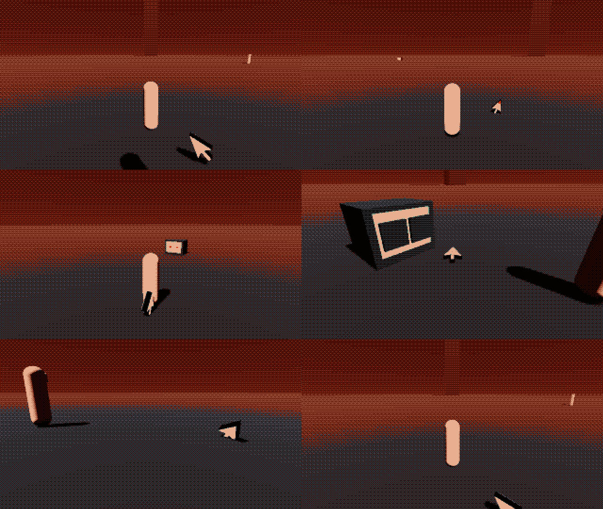

# The Stray

A lost arrow cursor, dog-sized (0.6 m), that adopts the little man. It is from the frame, not
from any room, so it is bone and black only and never vocalises. It does three things the story
needs: it points at what is worth looking at, it hides behind his legs from a television that is
watching, and it curls up beside one that has closed its eyes.



## Putting it in a room

Instance `res://companions/stray/stray.tscn` anywhere in your room scene. That's all.
It finds the player on arrival (the `player` group), appears at his heel and starts following.

- **Things to look at**: add a `StrayInterest` (a `Marker3D`, `stray_interest.gd`) on a landmark,
  a door, a hidden object. When he comes within `notice_radius`, the Stray runs ahead, clicks, and
  points with its tip until he turns the camera toward it. `priority`, `once`, `cooldown`,
  `enabled`; signals `pointed` and `acknowledged`.
- **Televisions**: every `WatchingSet` in the room is picked up by itself. Open or drooping eyes
  scare it; closed eyes are a place to sleep. For anything else that stares, add a `StrayStare`
  (`stray_stare.gd`) and keep its `awake` in step. Use `reaction = EDGE_ON` for huge far stares
  such as the Watcher: the Stray keeps following but turns edge-on to it, so it nearly vanishes.
  `fear_radius`, `rest_radius`, `curl_offset`.
- **Ink**: the tip borrows the room's ink for the one blink when it points. With
  `ink_from_story` (default) it reads the room's `gives_ink`, else what he carries, else the last
  ink planted in the hub. In the drained hub it has nothing to borrow and blinks with no colour.
  `set_ink(color)` to override.

## What it does on its own

| When | It |
|---|---|
| He walks | hops at his heel, on the camera side; tiny pats at a walk, long bounds at a run with three fading mouse-trail after-images |
| Something interesting is near | runs ahead, clicks (a dip, a blink with an ink tip, a ripple, a double tick), points, glances back at him, and hops twice when he looks |
| An awake television is near | tucks behind his legs, crouched and trembling, edge-on to the set, peeking round now and then |
| Its eyes close | shakes itself off like a wet dog |
| He lingers by a sleeping set | trots over, circles twice, lies down nose to the set, and pulses slowly like a sleeping machine's light |
| He stands still | looks up at him after 3 s, noses about after 10 s, and very rarely does the busy-cursor spin |
| He gets 45 m away (a fall, a teleport) | dissolves through the dither and reappears at his heel with a click |

## Story code

```gdscript
var stray := Stray.find_in(get_tree())
await stray.arrive(from, to)          # run in from off screen, skid, look up at him
await stray.walk_to(pos)              # hop somewhere; returns on arrival
await stray.sniff_around(node_or_pos) # nose about
await stray.look_at_camera(1.6)       # the one look at the player
stray.cower(near_pos)                 # hide behind him from something, until release()
await stray.point_at(node_or_pos, 3.0)
stray.curl_up(pos)                    # sleep here until release()
stray.blink()
stray.release()                       # back to being its own dog
stray.follow(other_node)
```

Signals: `arrived`, `pointed(thing)`, `mode_changed(mode)`. `stray.mode` is one of `FOLLOW`,
`POINT`, `COWER`, `CURL`, `SNIFF`, `LOST`, `SCRIPTED`.

## Sound

One sound only, a cursor tick (audio/AUDIO.md: nothing vocalises). It plays `cursor_tick` through
the `Sound` autoload when the audio work is in the project: steps are quiet ticks pitched to about
0.7, noticing something is a double tick. Without the autoload it uses a small synthesized tick
(`stray_sounds.gd`), or `tick_sound` if you set one.

## Files

- `stray.tscn`, `stray.gd`: the companion. Rig is `Rig/Squash/Model`, the pivot is the tail tip.
- `stray_cursor.glb`: the model from the Meshy thread (materials `rim` and `face`).
- `stray.gdshader`: bone face, ink tip, blink, dither dissolve; mostly self-lit so it reads in any light.
- `ripple.gdshader`: the click ripple.
- `stray_interest.gd`, `stray_stare.gd`: the markers rooms use.
- `tests/stray_test.tscn`: headless check. Run
  `godot --headless --path . res://companions/stray/tests/stray_test.tscn` (exit 0 = pass).
- Try it: `godot --path . -- --room=_stray_demo` (walk to the tower, the left set, the right set).
