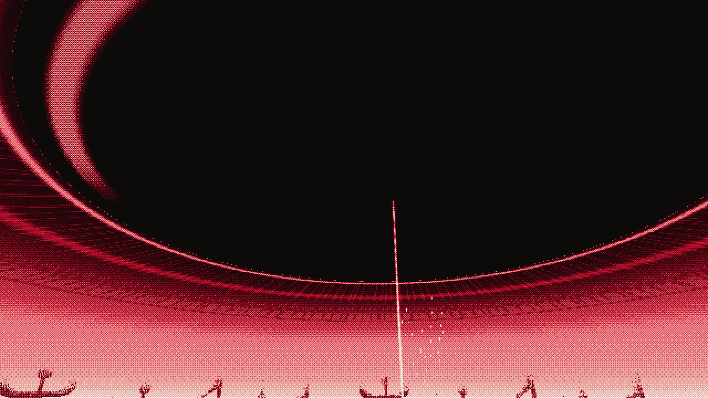

# The Red Grid

Crimson ink. A wire plain to every horizon sags under the Watcher's pupil, a black disc 3 km wide
hanging 900 m up, ringed by the target bands of his iris. The sag is 1.6 km across and 220 m deep.

## The walk (about 10 minutes on foot)

1. **Approach.** He arrives 1.8 km out, in daylight, beside a half-buried television that watches
   him take the first hole. The stare stands in the middle of the world as a thin shaft of light.
2. **Threshold.** Crossing into the pupil's shadow pulls the camera back: a speck under the eye.
3. **The eclipse.** The light goes over about 800 m of walking. The sky, fog and sun fade to a
   crimson night, his shadow vanishes, and only the wires stay lit.
4. **The rim.** The camera pulls back again over the bowl. Fog pours down its walls toward the
   bottom, and the slope speeds him inward.
5. **The bottom.** Under the stare he slows to a crawl. Six sockets wait on a crease around the
   pressed circle.

## The rule: holes are objects

- Six small black discs lie on the way in. Fog spirals down into each and the wires ripple toward
  them, so they can be found from hundreds of metres away. Walk over one to pick it up; they stack
  on his back.
- `interact` lays the top one a step ahead. **Wherever it is laid, the ground there is gone.** Step
  in and it swallows him, then spits him out beside it with the hole back in his hands. Failure is
  never death. `interact` beside a laid hole picks it back up.
- A laid hole is a blind spot. Within 9 m of one, the stare can't slow him.
- Laid in a socket, a disc seats with a thud, the eye flinches, the crease lights between filled
  neighbours and the television's lids droop.

## The mend

The sixth disc closes the cut. The pressed circle falls away into the dark with the six discs.
With nothing to press on, the grid springs level, overshooting into a bulge and settling, and
flings the fog upward. The stare goes out, fog closes over the pupil like a lid, and the light comes
back. One small disc rises out of the hole and goes to him. That is the crimson ink
(`gives_ink = crimson`, `complete()`), and `props/carry/crimson.tscn` is how he carries it. The
television closes its eyes. **The open hole is the way home**: step in and he drops to the spiral.
On later visits the region is already mended.

## Files

| File | What |
|---|---|
| `red_grid.gd` | The room: builds everything big in code, runs the rule, the eclipse, vistas and the mend |
| `grid.gdshader` | The wire plain: sag, pupil shadow, holes cut out, ripples, the crease and sockets |
| `eye.gdshader`, `sky.gdshader` | The iris ceiling (rings, fibres, catchlight) and the sky |
| `beam.gdshader`, `fog_fall.gdshader`, `fog_lid.gdshader` | The stare, the falling fog and the lid |
| `hole.gdshader`, `wisp.gdshader`, `plug.gdshader`, `horizon.gdshader` | Discs, fog drawn into them, the falling circle, the glyph skyline |
| `room_sfx.gd` | Fallback synth, used only when the shared sound system (`audio/`) isn't in the project |
| `art/` | `fog_fall_strip` and `horizon_glyph_skyline` from the designer's batch 02 |

Sound: with `audio/` present (PR #7) the room uses `bed_grid`, stone steps, lateness 1.8, a
`GiantVoice(giant_rumble)` under the pupil that swells with depth, `giant_boom` (800 m) when the
circle falls, `eyelids_close` for the lid, `ink_crimson_take` then `mend`. The stare narrows the mix
with `Sound.set_stare`. The television's broadcast comes with `props/watching_set.tscn`.

Look: with `shaders/` present the room hands DitherLook its own crimson palette and drives
`drain` with the stare's weight.

## Checking

- `godot --headless --path . res://rooms/red_grid/tests/check_red_grid.tscn` (exit 0 = pass)
  plays the whole room: pickup, laying, falling in, all six sockets, the mend, the ink and the way home.
- `xvfb-run godot --rendering-driver opengl3 --path . res://rooms/red_grid/tests/shots.tscn -- --shots=DIR`
  renders the review stills in `docs/`.
