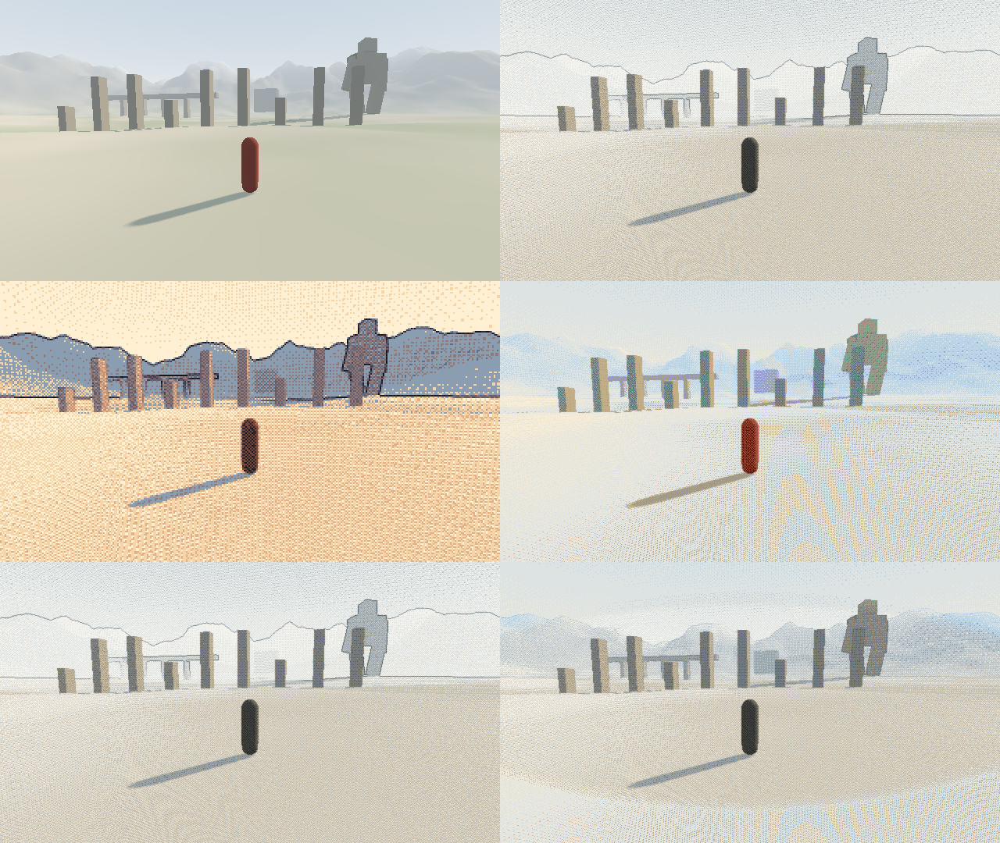
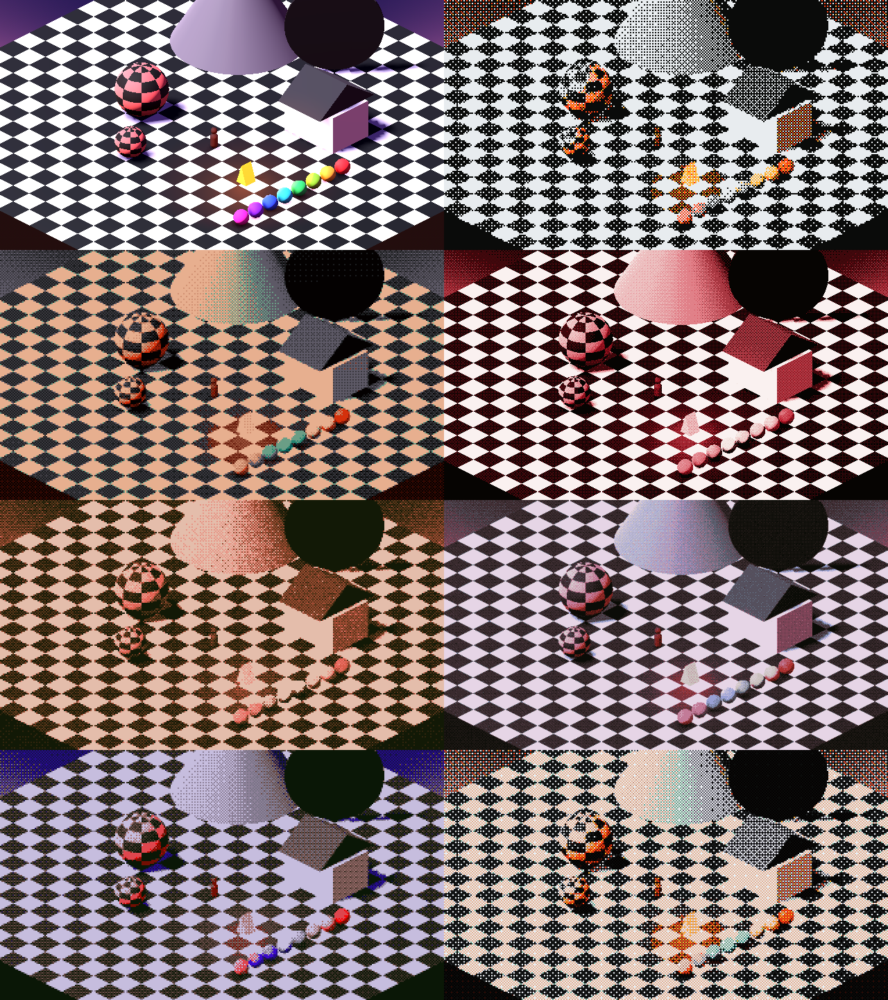

# Dither look

The game's pixel post-process. It takes the finished 640×360 frame, snaps it to chunky
virtual pixels, adds an ordered (Bayer) dither and maps every pixel to a small palette.





It is already wired in: `main.tscn` → `Main/PostProcess/DitherLook` (`shaders/dither_look.tscn`).

## Giving a room its own era

Add this to your room script and pick a `.tres` in the inspector:

```gdscript
extends Room

@export var dither_look: DitherLookSettings
```

It is applied while the screen is faded out, so the room opens already in its era. Rooms
without one get `default_look` (the sand spiral palette).

To change era mid-room (a rule twist, a memory, the face waking up), dissolve through the
dither pattern itself:

```gdscript
DitherLook.request(get_tree(), preload("res://shaders/presets/lakeside_1bit.tres"), 0.8)
```

## Making a look

Duplicate a preset in `presets/` (or New Resource → `DitherLookSettings`) into your room folder.

| Setting | What it does |
|---|---|
| `palette` | Up to 32 colours. This is the era. |
| `virtual_height` | 360 = native, 180 = 2× chunky, 120 = 3×, 90 = 4×. |
| `dither_spread` | ~0.9 for 1-bit, 0.2–0.35 for 8–16 colours, 0 = flat posterize. |
| `bayer_size` | 8×8 smooth gradients, 4×4 more console-like, 2×2 coarse. |
| `accent_threshold` | ~0.4 keeps a grey scene grey while saturated things (a fire) keep their colour. |
| `contrast` / `brightness` / `saturation` | Grade before the palette is applied. |
| `grain` | Static, world-anchored noise in the threshold. Paper/film texture, never flickers. |
| `soft_sampling` | Averages each virtual pixel (calm). Off = crisper thin lines (grids). |
| `invert` | Photographic negative before the palette (light becomes dark). |
| `ink` + `ink_min_saturation` / `ink_min_brightness` / `ink_hue_range` | The region's one living ink. Bright, saturated source pixels near the ink's hue (emissive fire, the Watcher's eyes) skip the palette and snap to `ink`, dithered at their edges. Keyed on the raw frame, so it works in 1-bit looks. `lakeside_1bit` is black + bone + ember. |
| `haze_steps` … `haze_sky` | Depth haze as a few flat layers instead of smooth fog, spaced logarithmically from `haze_start` to `haze_end` (metres), stepping toward `haze_color`. A far mountain sits behind several clear sheets of air. |
| `outline_*` | Ink line around things standing in front of much more distant things (a colossus against the sky, a ridge against the next ridge). Only past `outline_min_distance`, so landmarks get it and props don't. |

Haze and outline run in a small depth pass inside the 3D scene, so they need Forward+ or Mobile
(the game's renderer). On Compatibility they switch off and everything else still works.
If a room uses haze bands, turn its smooth `Environment` fog down or off.

Presets, each palette pulled from one of the reference stills:
`lakeside_1bit`, `sand_spiral_16bit`, `y2k_red_grid`, `pink_checker`, `cloud_sky`, `purple_face_grid`.
For the open world: `colossus_haze` (pale stone and haze, 5 haze layers, ink silhouettes),
`colossus_dusk`. For the ending: `dawn` (every ink at once) and `paper_margin` (bone white, almost empty).
`negative` (inverted, shadows solid, bone rim on far silhouettes) for being turned to stone.
`hub_inks_0` … `hub_inks_3`: the hub palette growing as inks come home (black, bone and sand first,
then ember, salmon and crimson, each step adding a third of the teal and palm-green ramps).

## Story hooks

```gdscript
var d := get_tree().get_first_node_in_group(DitherLook.GROUP) as DitherLook
create_tween().tween_property(d, "drain", 1.0, 2.0)   # bleed the frame to its darkest + lightest ink
d.eyelids_to(black_look, 0.2)                          # two almond lids close onto a look
d.eyelids_open_to(room_look, 0.3)                      # and open again
```

Borrow or swap the region's ink:

```gdscript
var ember := DitherLook.current_ink(get_tree())        # e.g. tint the Stray's arrow tip
d.set_ink_override(Color("c8102e"), 0.5)              # flash another ink for half a second
```

A palette that grows (the hub gaining inks) is just a sequence of looks with more colours:
`DitherLook.request(get_tree(), next_look, 0.8)` dissolves between them.

## Stable in motion

With `stabilize` on (default) the virtual pixel grid and the Bayer pattern travel with the
scenery instead of sitting on the screen, so the dither doesn't crawl ("shower door").

- **Perspective (FollowCamera):** every frame DitherLook measures how far the centre of the view
  slid across the screen and shifts the grid and pattern by that many whole pixels. Orbiting and
  looking around carry the pattern with distant terrain, sky and fog. The pattern is never rotated
  against the pixel grid, so there's no moire. Walking needs no correction: the follow camera
  keeps the scene almost still on screen (one stride changes about 2% of pixels), and near
  ground drifts only slightly, which reads as texture. Measured in the vast demo (0.37° orbit, upper half of frame):
  97.4% of pixels unchanged once aligned with the scenery, versus 90.8% without.
- **Orthographic:** the grid is anchored to the camera position and the camera is nudged onto
  whole screen pixels via `h_offset`/`v_offset` (its transform is never touched). After a
  7.37 × 3.61 px pan: 99.7% of pixels unchanged, versus 82% without.

## Demos

- `shaders/demo/vast_demo.tscn` (F6): perspective orbit camera on a huge plain with a colossus,
  ruins and a mountain ring. 1–8 looks, B blink, hold F to drain, S toggles stabilize,
  0 toggles the effect, WASD walk, arrows or mouse drag orbit, Q/E zoom.
  `-- --shots=DIR` and `-- --motion=DIR` save screenshots and the crawl test frames.
- `shaders/demo/dither_demo.tscn` (F6): the original isometric scene with the six still-based
  looks. 1–6 looks, 0 toggles, WASD walks.
